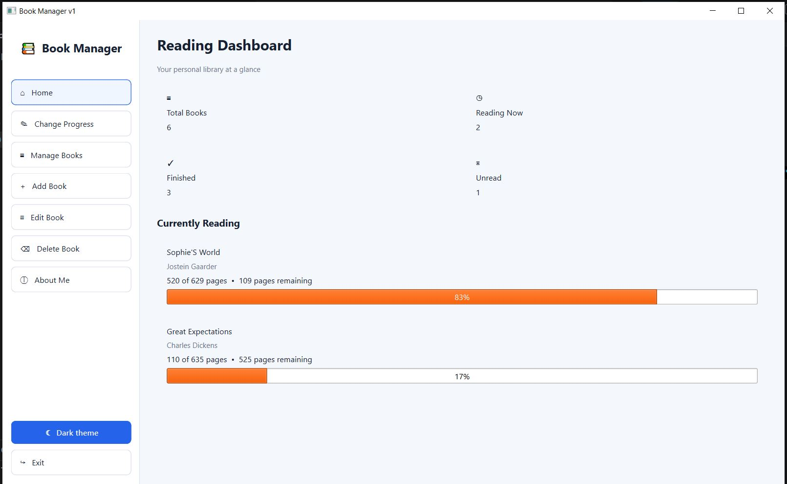
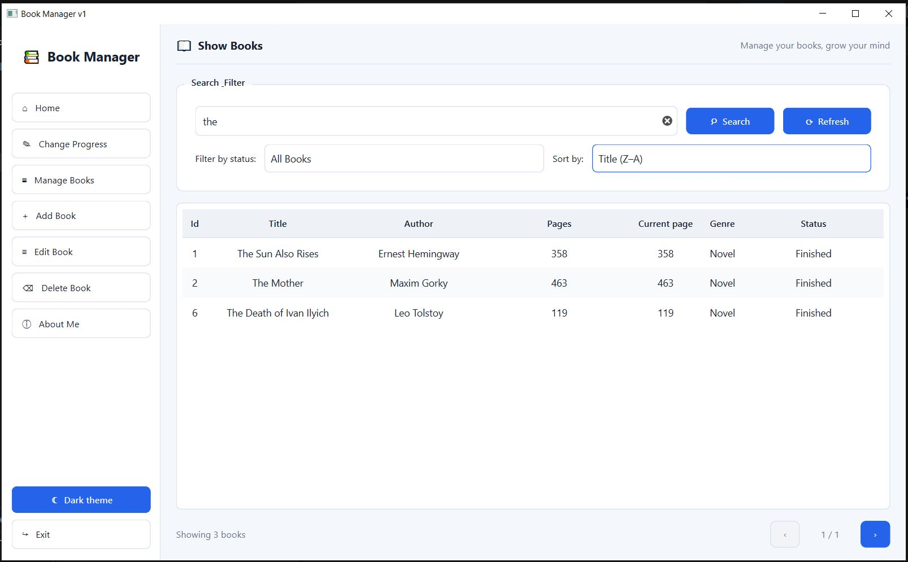
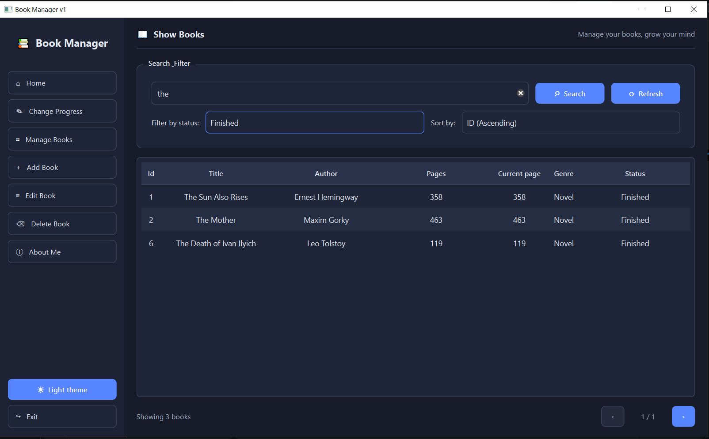
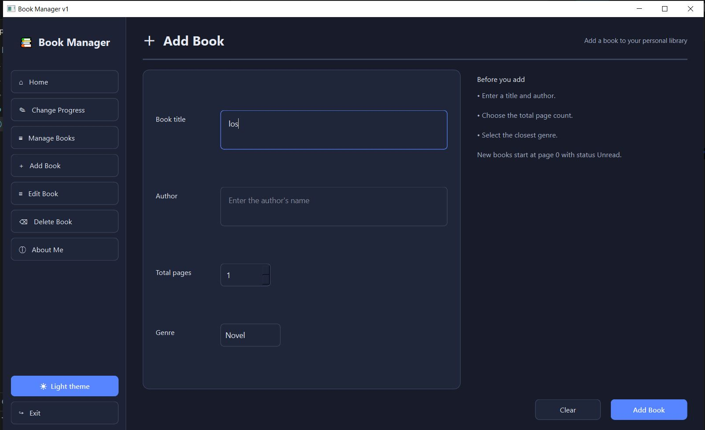

# 📚 Book Manager

A desktop application for managing personal book collections and tracking reading progress, built with Python and PySide6.

## 📌 About the Project

Book Manager is a desktop application designed to help users organize their personal libraries, manage book information, and monitor their reading progress.

The application provides a graphical user interface for adding, viewing, editing, deleting, and organizing books.

Book information is stored locally in JSON format.

## Screenshots

### Dashboard


### Main Interface


### Book Management


### Add Book


## ✨ Features

- **Add Books:** Add books with title, author, page count, and genre.
- **View Books:** Display your personal book collection.
- **Edit Books:** Update existing book information.
- **Delete Books:** Remove books from your collection.
- **Reading Progress:** Track the number of pages read.
- **Reading Status:** Organize books into three categories:
  - Unread
  - Reading
  - Finished
- **Search:** Find books by title or author.
- **Filter:** Filter books by reading status.
- **Sorting:** Organize books using different sorting options.
- **Dashboard:** View library statistics and current reading progress.
- **Dark & Light Themes:** Switch between visual themes.

## 🛠️ Technologies Used

| Technology | Purpose |
|---|---|
| Python | Main programming language |
| PySide6 | Desktop GUI development |
| Qt Designer | Visual interface design |
| JSON | Local data storage |
| Git & GitHub | Version control and project hosting |

## 📁 Project Structure

```text
Book-Manager/
│
├── main.py
├── .gitignore
│
└── data/
    ├── Books.json
    ├── database.py
    ├── style.py
    │
    ├── addbook.py
    ├── addbook.ui
    ├── addbook_ui.py
    │
    ├── change.py
    ├── change.ui
    ├── change_ui.py
    │
    ├── delete.py
    ├── delete.ui
    ├── delete_ui.py
    │
    ├── editbook.py
    ├── editbook_ui.py
    ├── main_ui.py
    │
    ├── showbook.py
    ├── showbooks.py
    ├── showbooks.ui
    └── showbooks_ui.py
```

## ⚙️ Installation

### 1. Clone the Repository

```bash
git clone https://github.com/dralirezah/Book-Manager.git
```

### 2. Navigate to the Project Directory

```bash
cd Book-Manager
```

### 3. Create a Virtual Environment (Optional)

```bash
python -m venv .venv
```

Activate it on Windows:

```powershell
.venv\Scripts\activate
```

### 4. Install Dependencies

```bash
pip install PySide6
```

### 5. Run the Application

```bash
python main.py
```

## 💾 Data Storage

The application uses JSON files to store book information locally.

Each book contains information such as:

- ID
- Title
- Author
- Total pages
- Current page
- Genre
- Reading status

No external database server is required.

## 🚀 Future Improvements

- Improve application architecture.
- Add more advanced library statistics.
- Improve data validation and error handling.
- Add automated testing.
- Improve user experience and interface design.

## 👨‍💻 Author

**Alireza**

- GitHub: [@dralirezah](https://github.com/dralirezah)

---

⭐ If you find this project useful, consider giving it a star!